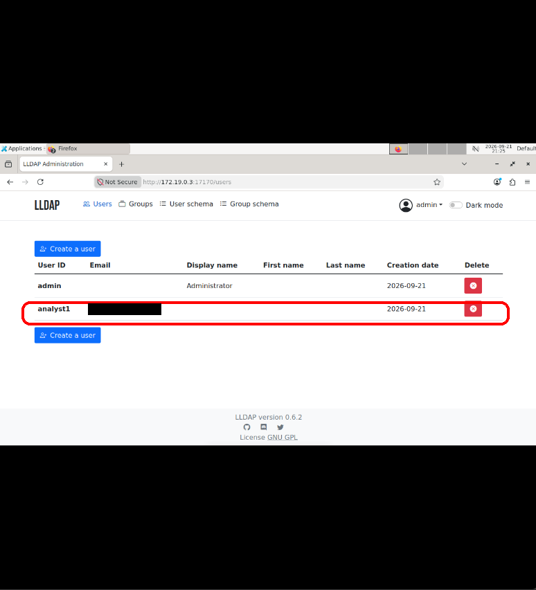
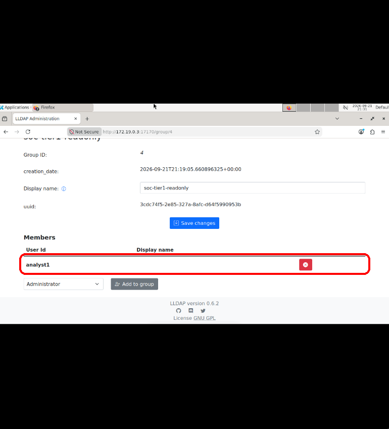
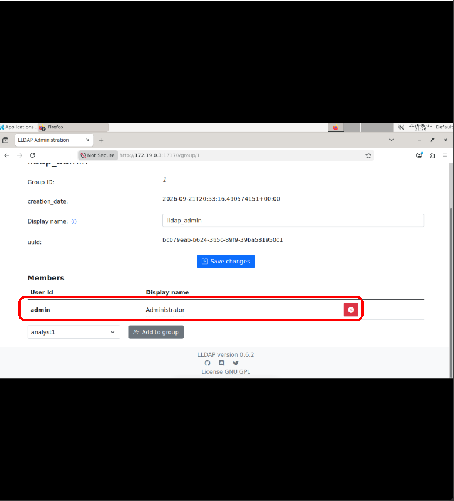
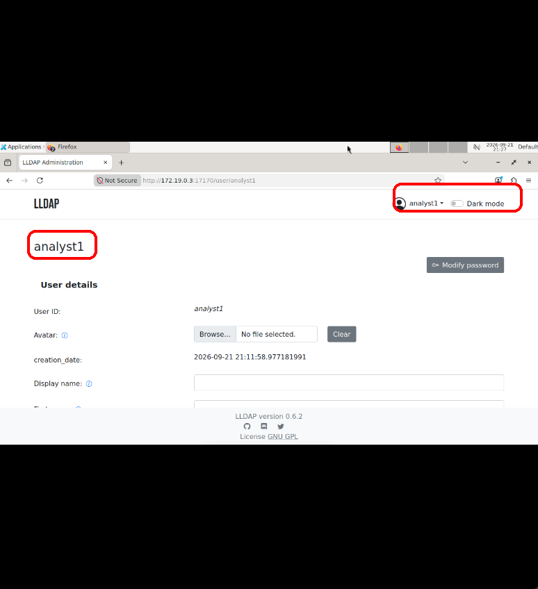
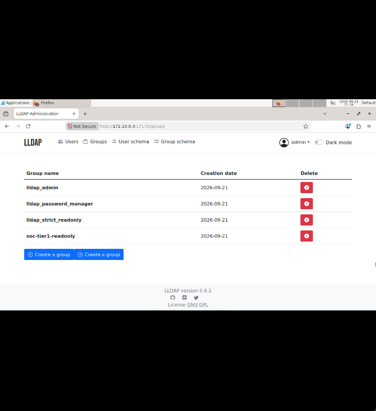

# CyberKy / LLDAP Least-Privilege Groups

Hands-on lab, Sep 2026.

A least-privilege access request in LLDAP (CyberKy "IAM LDAP: Create Your First Group Policy"). A new analyst needs read-tier access, not admin. I created the user, put them in a read-only group, kept them out of the admin group, then signed in as the analyst to prove it. Group membership is what drives privilege, and this is the smallest version of that.

## What I built

- Created user **analyst1** in LLDAP 0.6.2.
- Created group **soc-tier1-readonly** and added analyst1 as its member.
- Left **lldap_admin** with **admin** as its only member.
- Signed in as analyst1 to validate the account.

## What I learned

- analyst1 could only read; could not create groups, move groups, or update things.
- No admin authority or privileges unless admin assigned access. Membership drives privilege.

Interview line (coach-written at his request, from his one-page IAM Labs doc): "In LLDAP I put analyst1 in a read-only group and logged in as him to prove he could only read, not create, move, or update groups. He had no admin rights because group membership decides privilege."

## Key screenshots

Created analyst1 as a normal user in the LLDAP directory.

analyst1 is a member of the soc-tier1-readonly group only.

The lldap_admin group contains only admin, so analyst1 has no admin rights.

Signed in as analyst1 to confirm read-only, least-privilege access.

## Environment

| Object | Value |
| --- | --- |
| Lab | CyberKy IAM LDAP (LLDAP web UI) |
| App | LLDAP 0.6.2 |
| Users | admin, analyst1 |
| Custom group | soc-tier1-readonly (member: analyst1) |
| Built-in groups | lldap_admin, lldap_password_manager, lldap_strict_readonly |

## What broke / issues I fixed

Nothing broke in this sitting. The lab IP is ephemeral, so it's session proof, not a permanent host.

## Gaps

- The read-only behavior (can't create or move groups) is from my notes; the screenshots show the sign-in as analyst1 and the group memberships, not a denied action.

## How to redo it

1. Open the LLDAP UI for the CyberKy lab (version 0.6.2).
2. As **admin**, create user **analyst1**.
3. Create group **soc-tier1-readonly**; add **analyst1** as a member.
4. Open **lldap_admin** and confirm members are **admin** only — do not add analyst1.
5. Sign out; sign in as **analyst1** and capture user details.

## Demo walkthrough

1. Show Users: **admin** and **analyst1**.
2. Show Groups: custom **soc-tier1-readonly** next to the built-in LLDAP groups.
3. Open **lldap_admin** — only **admin** is a member (least privilege).
4. Open **soc-tier1-readonly** — **analyst1** is the member.
5. Show the session signed in as **analyst1**.
6. Explain in ticket language: membership drives privilege; the analyst can read what that tier allows and does not get admin unless assigned.

Full proof (all screenshots)

